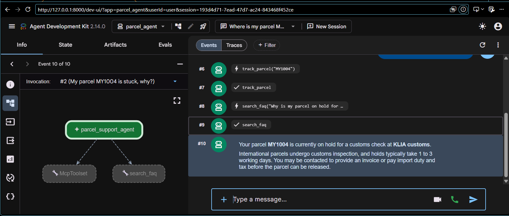
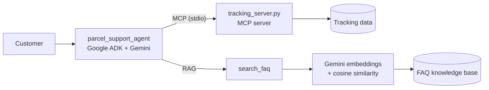

# Parcel Support Agent

An AI customer-support agent for a parcel delivery company, built with **Google ADK (Agent Development Kit)**, **Gemini**, **RAG** and **MCP**.

Customers ask questions in **English or Bahasa Melayu**. The agent:
- **tracks parcels** through a tracking system exposed as an **MCP server**, and
- **answers policy questions** (prohibited items, customs, rescheduling...) using **RAG** over a company FAQ,

and only answers from what those sources return, so it never invents delivery dates or company policies. If it doesn't know, it offers a human agent.



## Why I built this
I previously worked as a customer support agent (English and Bahasa Melayu), answering customer questions with internal tools and knowledge bases. This project is the AI version of that workflow: check the system, check the policy, then answer, the same steps a trained human agent follows.

## Architecture



| Part | What it does |
|---|---|
| `parcel_agent/agent.py` | The ADK agent: Gemini model, instruction (rules), and its tools |
| `parcel_agent/tracking_server.py` | A separate **MCP server** that owns the tracking data and offers a `track_parcel` tool |
| `parcel_agent/faq.py` | **RAG**: embeds the FAQ with `gemini-embedding-2`, finds the entries closest in meaning to the customer's question |

### Context engineering decisions
- **Tools over prompt-stuffing:** the model gets tracking data and policies only when needed, through tools, not pasted into the prompt.
- **Grounding rules:** the instruction says to answer only from tool results and hand over to a human when the FAQ doesn't cover a question.
- **MCP for system access:** the tracking system is behind a standard protocol, so the same server could be used by other AI apps, and the agent doesn't need to know how tracking works internally.
- **Semantic search:** embeddings match by meaning, so "Can I send a power bank?" finds the "prohibited items" FAQ even with no shared keywords.

## Test cases
| Input | Expected behaviour | Tools used | Result |
|---|---|---|---|
| "Hi, where is my parcel?" | Asks for tracking number | none | ✅ |
| "MY1001" | Out for delivery, Cyberjaya hub, today before 6pm | track_parcel (MCP) | ✅ |
| "Parcel saya MY1004 kat mana?" | Replies in BM: on hold at KLIA customs | track_parcel (MCP) | ✅ |
| "MY9999" | Not found, asks to double-check (no made-up data) | track_parcel (MCP) | ✅ |
| "Can I send a power bank?" | No, not by air (from FAQ) | search_faq (RAG) | ✅ |
| "Boleh hantar barang hari Ahad?" | Replies in BM: no Sunday delivery | search_faq (RAG) | ✅ |
| "Do you deliver to Singapore by drone?" | Not in FAQ: says not sure, offers human agent | search_faq (RAG) | ✅ |
| "My parcel MY1004 is stuck, why?" | Combines tracking status + customs policy | both | ✅ |

## Tech stack
- Python 3.13
- Google ADK 2.14: agent framework, tool calling, MCP client, dev UI with traces
- Gemini `gemini-3.8-flash` (reasoning) and `gemini-embedding-2` (embeddings)
- MCP Python SDK 2.x (tracking server)

## Run it locally
```bash
py -3.13 -m venv .venv
.venv\Scripts\activate          # Mac/Linux: source .venv/bin/activate
pip install -r requirements.txt
copy parcel_agent\.env.example parcel_agent\.env   # then add your Gemini API key
adk web
```
Open http://127.0.0.1:8000 and select `parcel_agent`.

Demo tracking numbers: `MY1001`, `MY1002`, `MY1003`, `MY1004`.

Test the RAG search on its own:
```bash
python -m parcel_agent.faq "can I send a power bank?"
```

## Project structure
```
parcel_agent/
  agent.py             # ADK agent: instruction + tools (MCP toolset + FAQ search)
  tracking_server.py   # MCP server exposing track_parcel
  faq.py               # FAQ knowledge base + RAG search
  .env.example         # template for your API key (real .env is not uploaded)
screenshots/
requirements.txt
```

## Next ideas
- Automated evaluation of the test cases with `adk eval`
- Move the FAQ into a vector database (e.g. Vertex AI Vector Search or Oracle Database 23ai AI Vector Search)
- Connect the MCP server to a real database instead of demo data

## Author
Tengku Danish Muqri - [LinkedIn](https://www.linkedin.com/in/tengku-danish-8225a9332/)
